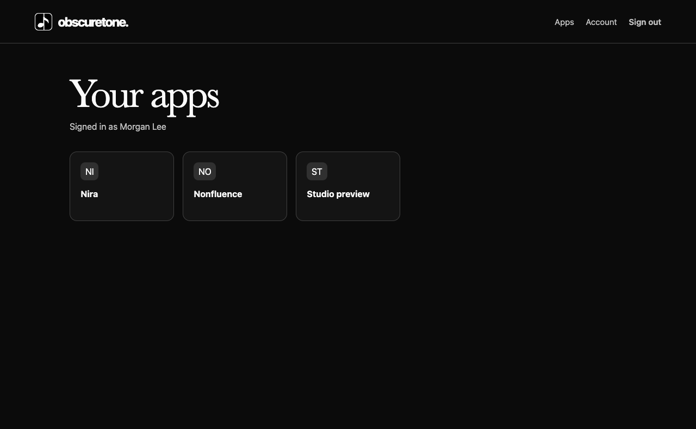

# ntka

A self-hosted Sanic identity provider for a single owner and individually granted guests. Passkeys belong to individual accounts. A guest sees and can sign in to only the sites the owner grants them. Obscuretone Identity is the first deployment.



The screenshot shows a demo guest account with fictional site grants. See how NTKA fits into the [self-hosted stack](https://obscuretone.com/posts/en/self_hosted_tools).

## Fresh MariaDB installation

Use Python 3.11 or newer, MariaDB 11.4 or newer, and a trusted HTTPS origin.
Provision a dedicated empty database. The simplest same-host setup uses a
MariaDB account with Unix socket authentication and a matching OS service
account. For example, with an OS user called `ntka`:

```sql
CREATE DATABASE ntka CHARACTER SET utf8mb4 COLLATE utf8mb4_nopad_bin;
CREATE USER 'ntka'@'localhost' IDENTIFIED VIA unix_socket;
GRANT ALL PRIVILEGES ON ntka.* TO 'ntka'@'localhost';
```

Set the values in [the configuration template](deploy/identity-mariadb.env.example)
for the service and CLI. Set `IDENTITY_DATA` to a private directory owned by the
service account and outside the release checkout. Start with a deliberate HTTPS
issuer and keep its hostname stable. Run the following with that environment
as the service account:

```sh
python3 -m venv .venv
.venv/bin/python -m pip install -r requirements-mariadb.txt
.venv/bin/python -m identity init
.venv/bin/python -m identity serve --port 8799
```

Initialization builds the MariaDB schema and creates the private signing key
outside the checkout. Repeating it verifies the existing key. Back up MariaDB
and the signing key together in encrypted, access-controlled storage. To move
an existing instance, preserve the issuer and key and follow the migration
procedure below. Configure the reverse proxy to forward the configured host
to loopback and omit authorization and token URLs from access logs.

## Local development with SQLite

Use Python 3.11 or newer, SQLite 3.35 or newer, and a trusted HTTPS origin. Set the reverse proxy to pass your configured host, forward to loopback, and leave authorization and token URLs out of access logs.

```sh
python3 -m venv .venv
.venv/bin/python -m pip install -r requirements.txt
export IDENTITY_ORIGIN=https://login.example.com
export IDENTITY_DATA=/path/to/private/identity-state
.venv/bin/python -m identity init
.venv/bin/python -m identity serve --port 8799
```

Keep the origin stable. WebAuthn credentials are bound to its hostname, and relying parties use it as the OpenID Connect issuer. The process serves one Sanic worker and stores identity state on local disk. Run initialization and owner commands as the service user with the same environment and working directory.

The included Debian deployment uses systemd, nginx, Certbot, and two DNS names pointed at the server. It targets Obscuretone and uses SQLite unless storage settings and requirements are changed. The fresh MariaDB instructions above use a dedicated service account and its own environment. For another installation, configure your hostnames, state paths, and TLS conventions. The Certbot flow expects an existing ACME account and nginx TLS options under `/etc/letsencrypt`.

The included updater handles code-only changes when the installed dependencies and proxy configuration match the checkout. It preserves the database and keeps the previous code available for rollback. Back up state before upgrading dependencies or deployment settings.

## Branding

Set `IDENTITY_NAME` for page titles and the WebAuthn display name. Set `IDENTITY_WORDMARK` for the text in the header. Set `IDENTITY_LOGO_FILE` to the absolute path of a service-readable SVG, PNG, WebP, or ICO file up to 512 KiB. An uploaded logo file is used in the header and as the browser favicon. Set `IDENTITY_HERO_FILE` to an optional local image for sign-in pages.
Set `IDENTITY_CSS_FILE` to a site-wide stylesheet. For OIDC client themes,
set `IDENTITY_SITE_CSS_DIR` and name each stylesheet `<client-id>.css`.
For example, use `work-portal.css` for a client with ID `work-portal`.
Client CSS loads after the main stylesheet and site theme. Keep public CSS
and images free of embedded secrets. Restart the service after changing the
site-wide branding configuration. The configured issuer hostname and passkey relying-party ID are independent of these display settings.

## Enroll the owner and invite guests

```sh
.venv/bin/python -m identity owner-invite --name 'Owner' --email owner@example.com
```

Open the 15-minute enrollment link on your own device, register a passkey, and sign in. Under **Account**, add a backup passkey after confirming the existing one. The owner can invite guests, register OIDC clients, and change access in **Administration** at `/manage`. Administrative mutations require a passkey sign-in from the last five minutes.

Guest enrollment links work once and expire after 24 hours. Share them privately. For a guest who loses their passkey, the owner can reset the guest's passkeys from Administration. This revokes all of the guest's passkeys, provider sessions, and tokens, and issues a 15-minute replacement enrollment link.

Owner recovery requires local server access. This command revokes the previous passkeys, provider sessions, and tokens and prints a one-time replacement link.

```sh
.venv/bin/python -m identity recover --email owner@example.com --revoke-all-passkeys
```

## Email and password signup

Enable guest signup by setting `IDENTITY_SENDMAIL` to the absolute path of a
sendmail-compatible executable and `IDENTITY_MAIL_FROM` to an authorized
sender address. The executable receives a plain-text verification email with
`-i -t`. Use a local mail transfer agent or any compatible transport, including
a configured Nailgun broker. To send through the Mailgun API instead, set
`IDENTITY_MAILGUN_URL` (an API origin such as `https://api.mailgun.net`),
`IDENTITY_MAILGUN_DOMAIN`, and `IDENTITY_MAILGUN_KEY_FILE` to a private file
containing the domain sending key, along with `IDENTITY_MAIL_FROM`. Set `IDENTITY_SIGNUP_DAILY_LIMIT` to bound
verification messages across all accounts (default 30 per rolling day).

Users verify their email before setting a password and receive no site grants
until the owner assigns them. Existing passkey accounts keep their credentials.
The owner continues to use a passkey.

## Connect a site

1. Register the site in **Administration** with its HTTPS launch URL and the exact OIDC callback URL documented by the site or its authentication proxy.
2. Configure the site using the issuer, the ID and one-time client secret shown at creation, and scopes `openid profile email` as needed. Enable Authorization Code flow with S256 PKCE and `client_secret_basic` or `client_secret_post`.
3. Grant access individually and test both an allowed and an unassigned account against the direct site URL.

The supported discovery endpoint is `/.well-known/openid-configuration`. Set relying-party policy using the immutable `sub` claim. Accounts created
through email verification have `email_verified: true`.

Okta-style org authorization server OIDC paths are available at
`/oauth2/v1/authorize`, `/oauth2/v1/token`, `/oauth2/v1/userinfo`, and
`/oauth2/v1/keys` for the authorization code flow above. Set
`IDENTITY_OKTA_ENDPOINTS=1` to advertise those endpoints in discovery.
The issuer remains the configured root HTTPS origin. Existing clients can use
the original OIDC paths.

Revoking a grant invalidates provider-side codes and opaque access tokens immediately. Relying parties control their own issued browser sessions and can keep them until their configured expiry. Plan their session lifetime and termination behavior accordingly. The current profile uses confidential clients, RS256 ID tokens, five-minute access tokens, and no refresh grant or federated logout.

## Verification and operations

```sh
.venv/bin/python -m pip install -r requirements-dev.txt
.venv/bin/python -m unittest discover -s tests -v
```

The integration tests simulate a WebAuthn authenticator and verify its signed assertions, validate an ID token against JWKS, and exercise admin access, per-site authorization and revocation, code replay, and guest recovery. Formal OpenID Foundation conformance testing is a separate step.

Back up the database using SQLite's backup API or while the service is stopped. Retain `signing.pem` and the database together in encrypted, access-controlled storage. Treat invitation links and client secrets as credentials. The repository contains source and sample configuration. Keep live signing material and identity state outside the checkout.

### Rehearse a MariaDB migration

Install `requirements-mariadb.txt` and provision a dedicated empty MariaDB 11.4
database. Use a consistent SQLite backup with its original `signing.pem`. Put
the same signing key in the target `IDENTITY_DATA` directory. The migration
verifies the key and compares the stored rows inside the import transaction.

```sh
export IDENTITY_STORAGE=mariadb
export IDENTITY_DATA=/path/to/rehearsal-data
export IDENTITY_MARIADB_DATABASE=ntka_rehearsal
export IDENTITY_MARIADB_USER=ntka_rehearsal
export IDENTITY_MARIADB_PASSWORD_FILE=/path/to/db-password
export IDENTITY_MARIADB_SOCKET=/path/to/mariadb.sock
python -m identity migrate-mariadb --source /path/to/sqlite-backup
python -m identity init
```

For local TCP, leave `IDENTITY_MARIADB_SOCKET` unset and set
`IDENTITY_MARIADB_PORT` if MariaDB uses a port other than 3306. Set the same
storage variables for the web service and the owner commands. Include the
database and signing key in future backup and recovery rehearsals.

To run the automated migration test, point the MariaDB variables at a separate
empty fixture database and run the suite with `NTKA_TEST_MARIADB=1` and
`IDENTITY_STORAGE=sqlite`. The test creates its own SQLite identity and checks
session, signing-key and passkey continuity on the imported database.
Run the fresh MariaDB test with `NTKA_TEST_MARIADB_FRESH=1` and a different empty
fixture database. It checks initialization, key matching and owner passkey sign-in.

Verify discovery and JWKS, the existing owner passkey, an existing session,
and a granted and denied relying-party sign-in before scheduling a cutover.
A real cutover needs a final SQLite backup with writes paused. Retain the
SQLite source for rollback and account for MariaDB writes before restoring
service from that snapshot. SQLite remains the default storage backend.
